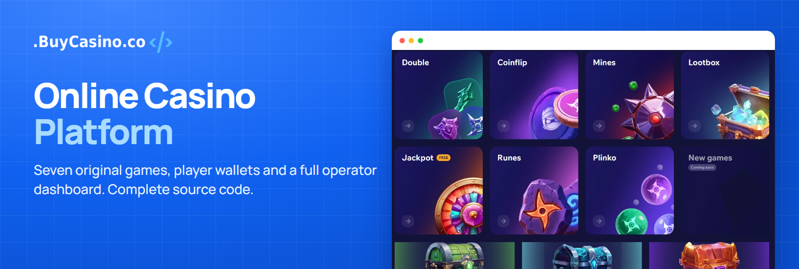
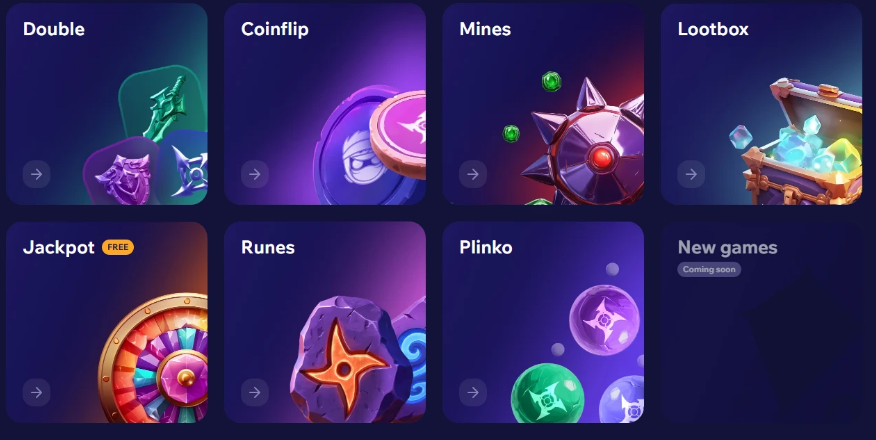
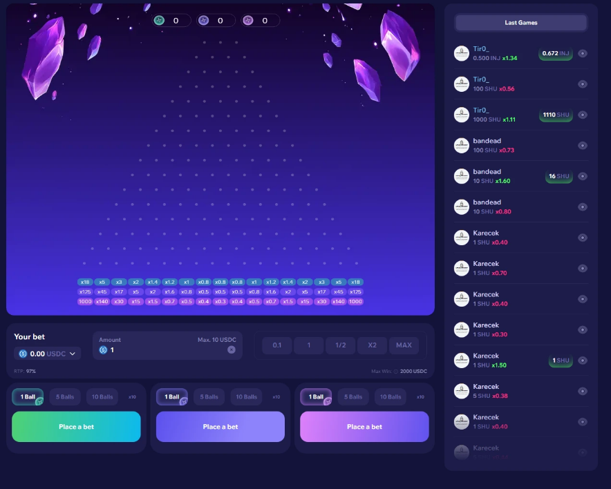
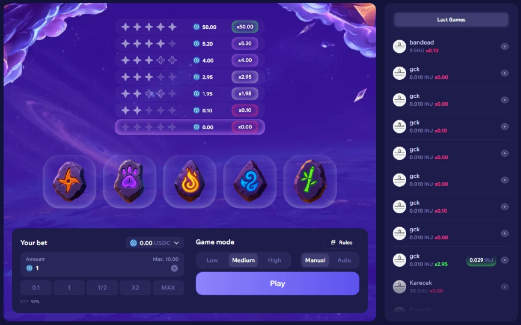
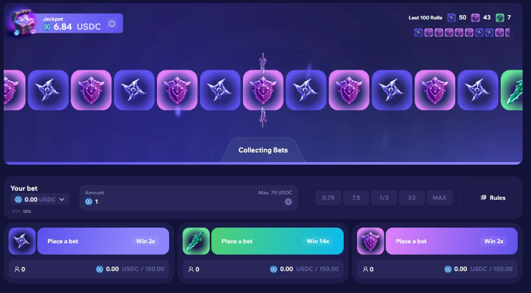
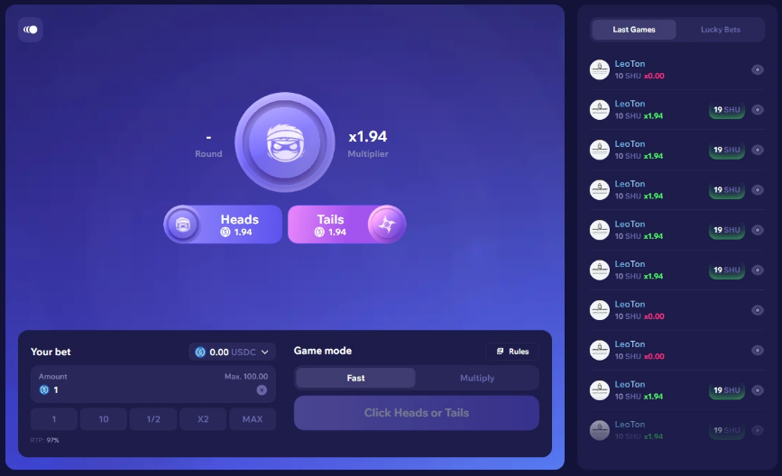
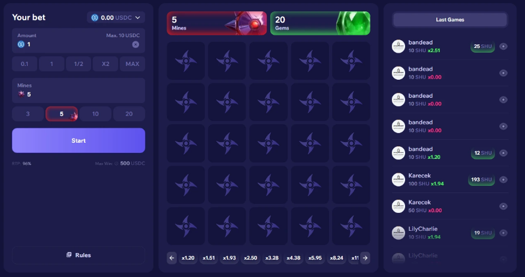
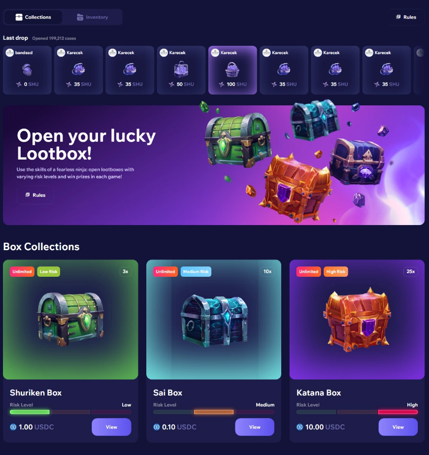

# Online Casino Platform

A complete online casino with seven original games, player wallets, rewards, live chat, affiliates and full operator controls. Sold as a one-time license with the full frontend and backend source code.

## Key Features

### Original Games
- Plinko, Runes, Double, Coinflip, Mines, Lootbox and Jackpot in one responsive lobby
- Lootbox inventory with configurable risk tiers
- Game history and player statistics

### Player Accounts and Wallets
- Player accounts with multi-currency wallets
- Authentication, wallet and payment integrations included

### Engagement and Growth
- Rewards and promo codes
- Affiliate system
- Live chat

### Operator Dashboard
- Manage players, games, payments, promotions and platform settings
- Rebrand the platform and make it your own

### Responsive Interface
- Built for desktop and mobile
- Multi-language ready

## Tech Stack

React · TypeScript · REST API · WebSocket · MySQL / PostgreSQL · Docker

## What's Included

- Complete frontend and backend source code
- Player website and casino lobby
- Admin dashboard and database schema
- Reward, affiliate, lootbox and chat modules
- Setup documentation and technical support
- Game API access, with no separate purchase needed

## Get it here

**[Get the platform](https://buycasino.co/casino-platform/)** · **[Admin panel demo](https://demo.buycasino.co/admin-demo/)** · **[Contact our team](https://buycasino.co/contact/)**

## Screenshots

### Game Lobby

### Plinko

### Runes

### Double

### Coinflip

### Mines

### Lootbox

---

> Copyright © 2026 BuyCasino.co. All rights reserved.
